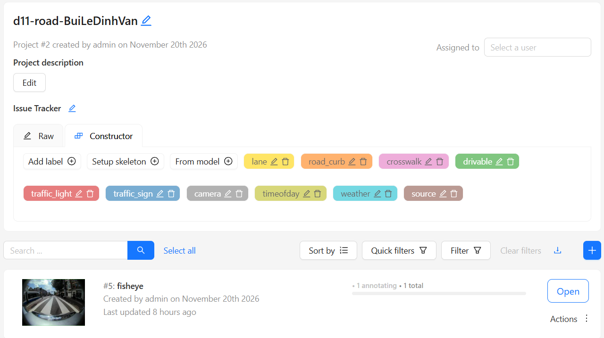
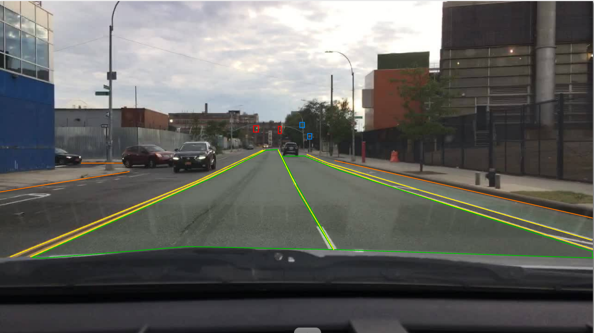
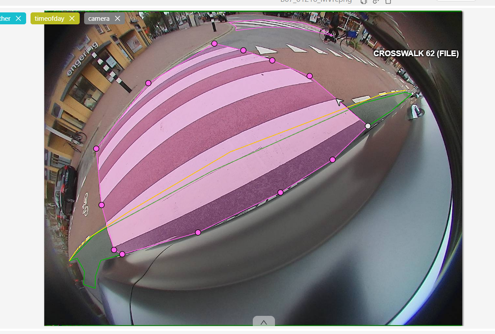
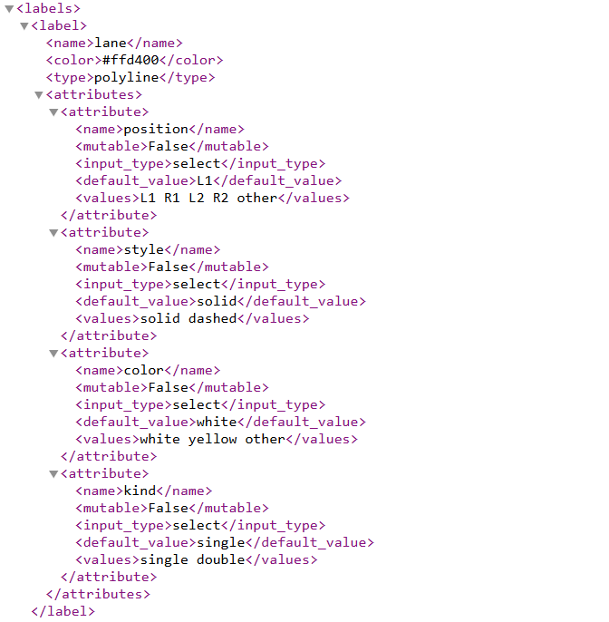

# Báo cáo cá nhân — Ngày 11
Họ tên: Bùi Lê Đình Văn               Mã học viên: 2A202603124
Phiên bản CVAT (Help → About): <điền version CVAT trên server lớp>
Guideline: Road v1.0    Lần nộp (`revision` trong manifest): 1
Thời điểm export (ngày giờ trên CVAT): 2026-11-20 (21:11–21:26 và lần export cập nhật sau sửa)    Số lần nộp lại sau Rework: 0

## 1. Kiểm project
| Mục | Đúng như guideline Road v1.0? | Ghi chú |
| --- | --- | --- |
| 6 label, đúng kiểu | Đúng | `lane` (polyline), `road_curb` (polyline), `crosswalk` (polygon), `drivable` (polygon), `traffic_light` (rectangle), `traffic_sign` (rectangle) |
| Thuộc tính và giá trị | Đúng | Kiểm tra `Details` sau khi tạo hình/tag để đổi khỏi giá trị mặc định đầu danh sách |
| 4 tag ảnh | Đúng | `camera`, `timeofday`, `weather`, `source`, mỗi tag có thuộc tính `value` và đặt `camera` trước |

Cách kết thúc polyline trên bản CVAT này: Bấm phím `N` sau khi đặt điểm cuối của polyline.
Cách đặt tag ảnh trên bản CVAT này: Dùng công cụ Tag ở thanh bên trái, thêm tag (`camera` trước tiên), sau đó mở `Details` chỉnh đúng giá trị `value`.

## 2. Số lượng đã gán
| Task | Ảnh | lane | road_curb | crosswalk | drivable | traffic_light | traffic_sign |
| --- | ---: | ---: | ---: | ---: | ---: | ---: | ---: |
| front | 12 | 36 | 13 | 10 | 26 | 26 | 13 |
| front-extra (đã làm 0 / 4) | 0 | 0 | 0 | 0 | 0 | 0 | 0 |
| fisheye | 8 | 4 | 2 | 11 | 10 | 6 | 1 |
| fisheye-extra (đã làm 0 / 4) | 0 | 0 | 0 | 0 | 0 | 0 | 0 |

## 3. Bảng ca khó
| Ảnh | Nhãn | Phân vân giữa | Đã chọn | Lý do |
| --- | --- | --- | --- | --- |
| A03 | `traffic_sign` | Các nhóm `group` cho cụm 3 biển nhỏ trên cột bên trái | Nhóm gần nhất / `other` | Cụm 3 biển nhỏ xếp dọc trên cột bị nhòe/mất chi tiết không đọc rõ chữ hay ký hiệu nên chọn nhóm gần nhất theo chức năng/`other` và ghi chú |
| A04, A08, A09, A11 | `lane` | Gộp 2 nét vạch đôi thành 1 polyline hay giữ 2 polyline cùng `position` | Giữ riêng từng vạch với `kind = double` | Vạch đôi gồm hai đường song song nên vẽ riêng theo từng vạch (không gộp), cảnh báo trùng `position` của `lint` là do vạch đôi |
| A05, A06, A09 | `lane` | Vẽ thêm `L1`/`R1` để hết cảnh báo `QC1-02` hay bỏ trống | Không vẽ thêm, giữ nguyên | Mặt đường thực tế không có vạch sơn ở vị trí thiếu (`A05` thiếu L1/R1, `A06` thiếu R1, `A09` thiếu R1), không vẽ bịa và ghi để miễn `QC1-02` |
| B01–B08 | `lane`, `drivable`, `traffic_sign` | Vùng cong fisheye, viền ảnh và thân xe | Theo cung cong, không gán thân xe, `position = other` ở B05–B08 | Ảnh fisheye biến dạng mạnh ở rìa; vạch thẳng ngoài đời cong trên ảnh, thân xe mình không gán nhãn và camera hai bên dùng `position = other` |

## 4. Phiếu QC 1 nhận được
Bạn kiểm lô của tôi: Nguyễn Hán Trường Giang  Quyết định nhận được: <điền quyết định của Giang>
| Mã lỗi | Số lỗi | Đồng ý? | Đã sửa? |
| --- | ---: | --- | --- |
| QC1-03 | 2 (ban đầu ở `B06`, `B07`) | Có | Đã sửa (`position = other` cho `B06`, `B07`) |
| QC1-04 | 7 (ban đầu ở `A03`, `A06`, `A08`, `A11`, `A12`) | Có | Đã sửa (đổi chiều polyline bằng `Switch orientation`) |
| QC1-02 / QC1-05 | 4 cảnh báo thiếu L1/R1 & 5 cảnh báo vạch đôi cùng `position` | Có | Đã kiểm lại: đường không có vạch thật sự & vạch đôi đúng `kind = double` |

## 5. Kiểm file export
| File | Mở lại được? | Số shape ảnh 1 (job / file) | Số shape ảnh 2 (job / file) | Tag camera có trong XML? |
| --- | --- | --- | --- | --- |
| `builedinhvan-front.zip` | Có | `A01`: 9 shapes (`drivable 3, lane 4, traffic_sign 2`) | `A02`: 6 shapes (`drivable 3, lane 3`) | Có (`front`) |
| `builedinhvan-fisheye.zip` | Có | `B01`: 3 shapes (`crosswalk 1, drivable 1, traffic_light 2`) | `B02`: 7 shapes (`crosswalk 2, drivable 1, traffic_light 4`) | Có (`fisheye_front`) |

## 6. Ảnh chụp màn hình
1. Tab Labels của project:
   
2. Một ảnh camera trước đã gán đủ (làn, vùng lái, đèn/biển):
   
3. Một ảnh fisheye đã gán, phóng to đoạn polyline cong:
   
4. Một đoạn XML có <polyline label="lane">:
   
## 7. Tự đánh giá
Lỗi bạn mắc nhiều nhất hôm nay (theo mã QC1-xx), và cách tránh ở Ngày 20:
- Lỗi mắc nhiều nhất là `QC1-04` (vẽ polyline ngược chiều từ xa về gần ở một số vạch trên Set A) và để sót giá trị mặc định ban đầu ở một số thuộc tính/vị trí. Cách tránh ở Ngày 20: luôn bắt đầu click điểm đầu tiên ở sát đáy ảnh (gần xe) đi ra xa, kiểm tra lại chiều vẽ và mở `Details` chỉnh thuộc tính ngay sau khi vẽ xong từng hình.

Nhãn của bạn đi vào model ở đâu? Chọn một lỗi đã sửa và nói nó làm model học sai thế nào:
- Nhãn polyline làn và thuộc tính `position` đi vào quá trình huấn luyện nhận diện làn/điều hướng làn (`lane detection` / `row-anchor`). Khi gán `position = L1/R1` cho các vạch trên camera hai bên `B06` (`MVL`) và `B07` (`MVR`) thay vì `other`, mô hình sẽ học sai khái niệm làn trái/phải sát làn xe đang chạy trên góc nhìn ngang/fisheye, dẫn đến nhầm lẫn làn khi triển khai thực tế.

## 8. (Tùy chọn, buffer) Từ polyline đến đích row-anchor
| y | 720 | 680 | 640 | 600 | 560 |
| --- | ---: | ---: | ---: | ---: | ---: |
| x của chúng tôi | <điền> | <điền> | <điền> | <điền> | <điền> |
| x của bạn kia | <điền> | <điền> | <điền> | <điền> | <điền> |

